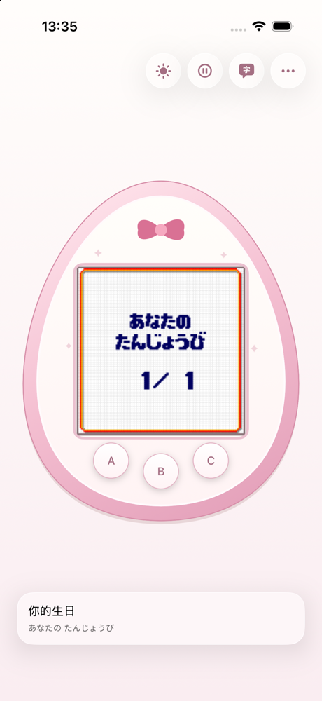

# iMeets

一个 iOS 上的**拓麻歌子 Meets / On** 模拟器外壳，内核采用 MIT 协议的 [nijiiro-egg](third_party/nijiiro-egg)，交互学习 [Open Meets](https://github.com/kanatallow/Open-Meets)。



iMeets 与任何 Bandai 官方产品无关，也未获 Bandai 认可。本仓库不提供固件。

## 功能

- **运行 8 MiB 的 Meets / On 固件。**
- **离线补时。** 回到前台时按真实离开时长追赶，并显示进度卡片；玩具时钟锚定手机时钟，补完后显示正确时间。
- **暂停养育。** 冻结成长、照料提醒、补时重放和玩具自己的时钟；恢复时把时钟对回手机时间，并跳过暂停的那段时间。
- **实时翻译面板。** 直接读取玩具自己的文字缓冲，用 ROM 字模做确定性匹配，全程本地完成。内置约 1,300 条本地词表覆盖 Sweets 菜单，超出词表的句子由系统端上翻译补充；面板常驻显示，空画面以「……」占位。
- **快速按键（实验性，可在设置中开启）。** 在固件把按键扫描例程放进 SRAM 的位置缩短消抖。实测按键到画面从 63 ms 降到 25 ms。补丁只作用于内存中的扫描例程，ROM 文件保持原样，并且字节校验通过后才会启用。
- **外观。** 真机与极简各有白天、夜间两套皮肤，可以分别设为「随系统切换」；另有小屏模式。顶栏提供白天/夜间、暂停养育、翻译和设置四个按钮。
- **按键触感。** 每个外壳按键按下时有一次轻触反馈，可在设置里关闭。
- **后台驻留**与本地通知、设备间 **Mixing** 联机。

## 环境要求

- macOS + Xcode（iOS 16+）以及装好 iOS target 的 Rust
- 真机或模拟器
- 你自己的 8 MiB 固件（`.bin`）

## 编译

Rust 内核与测试（Linux 或 macOS）：

```sh
cargo test --manifest-path rust/shell/Cargo.toml
```

测试通过 `POCKET_MEETS_ROM` 指定固件，设置后会自动加载。菜单语料测试依赖本地生成的真机抓屏 dump，`tools/` 中提供了生成脚本。

iOS：

```sh
rustup target add aarch64-apple-ios aarch64-apple-ios-sim
cargo build --release --target aarch64-apple-ios \
  --manifest-path rust/shell/Cargo.toml
cargo build --release --target aarch64-apple-ios-sim \
  --manifest-path rust/shell/Cargo.toml
open ios/PocketMeets/PocketMeets.xcodeproj
```

在 target 设置里选自己的 Development Team 后运行。Xcode 工程从 `target/aarch64-apple-ios{,-sim}/release` 链接静态库，并通过 bridging header 引入 `rust/shell/include/pocket_meets.h`。

Intel 模拟器需要另外编译一份：

```sh
cargo build --release --target x86_64-apple-ios \
  --manifest-path rust/shell/Cargo.toml
```

首次启动时导入固件。App 容器位于 Application Support，并已排除备份。

## 目录

| 路径 | 说明 |
|---|---|
| `third_party/nijiiro-egg` | MIT 模拟器内核（CPU、LCD、GPIO、RTC、SPI flash、声音） |
| `rust/shell` | 会话 pump、补时、按键补丁、文字缓冲、设置、FFI（`include/pocket_meets.h`） |
| `ios/PocketMeets` | SwiftUI App |
| `tools` | 字符串抽取、翻译表生成、字模/菜单研究、覆盖率检查 |
| `rust/shell/examples` | 无头探针：菜单遍历、延迟、按键扫描、时钟跳变 |

## 相关项目

- [Open Meets](https://github.com/kanatallow/Open-Meets) —— 安卓上的姊妹项目，本项目外壳学习其进行开发。
- [nijiiro-egg](https://github.com/oreo-fox/nijiiro-egg) —— 本项目内置的 MIT 内核。

## 法律声明

iMeets 是独立项目。Tamagotchi、Meets、On 及相关商标与美术资源归 Bandai 所有。本仓库不分发固件及其资源；模拟器内核为 MIT（Copyright (c) 2026 oreo-fox，见 [third_party/nijiiro-egg/LICENSE](third_party/nijiiro-egg/LICENSE)），外壳为 GPL-3.0。

## 协议

GPL-3.0 —— 见 [LICENSE](LICENSE)。内置的 `third_party/nijiiro-egg` 仍为 MIT；MIT 与 GPL 兼容，因此整体可以按 GPL-3.0 分发。
